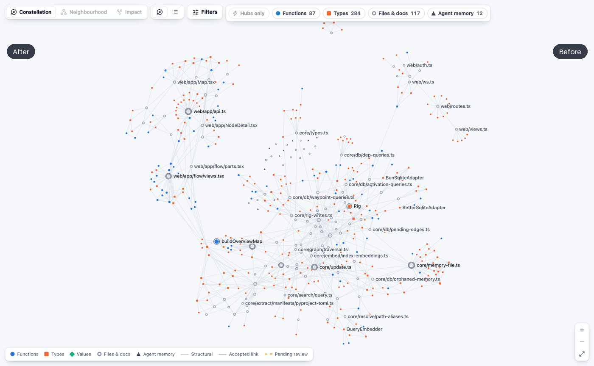
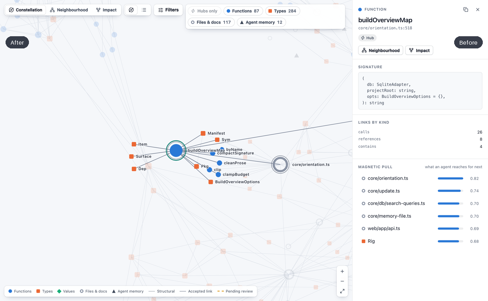

# Rig

**Watch your codebase become a constellation — and give your AI agent a map of it.**

<p align="center">
  <a href="https://www.npmjs.com/package/rig-constellation"></a>
  <a href="https://github.com/Astralchemist/rig/actions/workflows/ci.yml"></a>
  <a href="LICENSE"></a>
  
</p>

<p align="center">
  <a href="https://github.com/Astralchemist/rig/releases/download/v0.1.0/demo.mp4">
    
  </a>
  <br>
  <em><a href="https://github.com/Astralchemist/rig/releases/download/v0.1.0/demo.mp4">▶ Watch the full demo with audio</a></em>
</p>

Rig builds a local-first semantic knowledge graph of your project, renders it as an interactive map you can fly through, and exposes it to coding agents (Claude Code, Cursor, Codex, opencode) over MCP. Agents navigate by structure and by meaning, and they keep what earlier sessions decided, attached to the code it is about.

Everything runs on your machine. No API key, no upload, nothing leaves your laptop.

---

## Quickstart

In any project directory:

```bash
npx rig-constellation
```

(Have [Bun](https://bun.sh)? `bunx rig-constellation` works too.) That's the whole thing. One command:

```
  ⬡ Rig — mapping my-project
  http://localhost:7491

  ✓ initialized  ./.rig
  ✓ map live    http://localhost:7491
  → 1/6 extract      ██████████████████ 212/212
  → 5/6 hubness      ████████████████░░
  ✓ indexed     1,204 nodes · 3,891 edges · 212 files · 36 skills
  ✓ wired Claude Code  project
      wrote     .mcp.json
      wrote     .claude/settings.json
      wrote     CLAUDE.md

  press Ctrl-C to stop the map.
```

It initializes `.rig/`, opens the live map **first**, then indexes your code so the
graph assembles in the already-open browser tab in real time, and wires whichever
agent it detects into this project, listing every file it writes. The map title and
port are derived per project, so two checkouts can run side by side on stable,
distinct ports. Re-run any time, or use the explicit subcommands below.

> The command is `rig` (alias: `rig-constellation`). Prefer a global install?
> `npm i -g rig-constellation` (or `bun install -g rig-constellation`), then `rig start`.
> Installed locally with `npm i rig-constellation`? The binary lives in `node_modules/.bin` —
> run it with `npx rig start` (or install with `-g` to get `rig` on your `PATH`).

---

## What it can do

**Map and navigate code**
- **A live map of your codebase.** Files, symbols, calls, imports, tests and dependencies as a graph you can fly through in the browser. The map updates live while agents work. Select a node for its neighbourhood (typed links, notes, waypoints) or its impact tree; review proposed links, browse waypoints and read the orientation map in their own views. Light and dark, keyboard-driven, and usable on a phone.
- **Structural questions in one call.** Callers, callees, impact ("what breaks if I change X"), critical paths, neighbours and hubs, instead of grep-and-read.
- **Search in plain language.** "Where do we refresh expired sessions?" finds the code. Exact names, keywords (including identifier words, so "handle login" matches `handleLogin`) and on-device embeddings are fused into one ranking. A symbol name still returns that symbol first.
- **Orientation on demand.** `rig_overview` (also the MCP resource `rig://overview`, and `rig overview` on the command line) returns a compact markdown map of the repository, about 2,000 tokens long. It covers:
  - packages and their purposes
  - entry points
  - the most-referenced symbols with `file:line`
  - route and handler tables
  - where the tests live
  - recent decisions

  The map is cached and refreshed on every index, sync and file change.
- **Magnetic pull.** "What's related to X", ranked by graph distance, semantic similarity and recent activity, with the score components broken out.
- **Dependency intelligence.** Installed versions, declared-but-unused packages, imports with no declaration, and version conflicts across a monorepo. It covers npm and Python: PyPI names are matched to their import names (`PyYAML` → `yaml`), and the standard library is never flagged.

<p align="center">
  
  <br>
  
  <br>
  <em>The map before and after the canvas pass: the divider sweeps from before (right) to after (left).</em>
</p>

**Remember across sessions and agents**
- **Memory that survives re-indexing.** Index, sync, file edits and line moves keep everything agents attach to code:
  - waypoints (decisions, constraints, open questions)
  - aliases, annotations and promotions
  - proposed and accepted links

  If a symbol disappears, its memory is set aside rather than lost, and re-attached when the symbol comes back.
- **Waypoints** live outside the context window. They are searchable by meaning (`rig_waypoints query="…"`), and the next session can load the previous one's.
- **Automatic capture** (Claude Code). Hooks record what a conversation *settled*: agreed decisions, corrections, constraints and dead ends. The next session starts with a short brief of them. See [Automatic capture](#automatic-capture).
- **Human review where it matters.** Links an agent proposes wait for your accept or reject on the map, and every change can be undone step by step.
- **Portable memory.** `rig export-memory` and `rig import-memory` carry agent memory across fresh clones and machines.
- **One graph, many agents.** Claude Code, Cursor, Codex and opencode can all work on the same project at the same time. Writes are concurrency-safe and record which agent made them.

**Fit into your setup**
- **Wiring** goes into the current project by default (`rig install claude`), and `rig uninstall` removes exactly what was added. Each agent gets rig's approval policy in its own permission format; risky writes ask first.
- **A live graph.** A single file watcher per project keeps the graph current while you code.
- **Languages:** TypeScript, TSX, JavaScript, JSX, Python and Markdown, plus `package.json`, `pyproject.toml`, `requirements*.txt` and their lockfiles.

## Measured, not claimed

`scripts/bench` runs real agents (Claude Haiku 5.5 via OpenRouter) on 16 questions about [next-auth](https://github.com/nextauthjs/next-auth) at a pinned commit, and checks every answer automatically. With grep **and** rig available, as in a real agent session:
- Natural-language questions cost fewer tokens than with grep alone.
- Exact identifier lookups still cost more. The installed guide tells agents to use grep for those.
- Injecting the orientation map into every prompt cost more than it saved. That's why it's on demand.
- Across two sessions, waypoints the agent drops itself raised session-2 success from 30% to 70% (+40 pp, pre-registered bar passed) at 94% of the tokens. Automatic capture alone reached 50% (+20 pp) but used 116% of the tokens, so it failed the same bar: today it is a backstop to agent-dropped waypoints, not a replacement.

The raw results and reports are in [`scripts/bench/results/`](scripts/bench/results/).

---

## What your agent does differently

Without a map, an agent answers *"what breaks if I change `parseConfig`?"* by grepping the string and reading whatever files match — blind, lossy, and token-expensive.

With Rig it's one call:

```
rig_impact parseConfig
→ 7 transitive callers, ranked:
   loadSettings          calls · depth 1
   bootstrap             calls · depth 2
   __tests__/config…     tests · depth 1
   …
```

And *"what else should I look at?"* isn't a guess — `rig_pull` returns related anchors scored by graph distance, on-device embedding similarity, and recent activity, with the three components broken out so the ranking is **explainable, not a black box**:

```
rig_pull parseConfig
→ { node: "validateSchema", score: 0.81,
    components: { structural: 0.4, semantic: 0.9, recency: 0.7 } }
```

That ranked, self-explaining retrieval — not a flat grep dump — is the difference.

---

## Privacy & local-first

- Embeddings run locally via a small on-device model (`bge-small`). **No API key required.**
- The graph lives in `.rig/rig.db` in your project. `rig` auto-adds `.rig/` to your `.gitignore`.
- Nothing is uploaded. The map UI is served on loopback only and needs its per-project session token, with Host and Origin checks against other web pages; `rig start` opens it signed in.

---

## Wiring your agent

`bunx rig-constellation` auto-detects the agents you have installed and wires them **into
the current project** — it never edits your user-level config. To wire one explicitly:

```bash
rig install claude            # also: cursor · codex · opencode
rig install claude --global   # your user-level config instead: applies to every project
rig uninstall claude          # remove exactly what install added (--all · --global · --dry-run)
```

| Agent | Project (default) | `--global` |
|---|---|---|
| Claude Code | `.mcp.json` · `.claude/settings.json` (permissions, capture hooks) · `CLAUDE.md` | `~/.claude.json` · `~/.claude/settings.json` · `~/.claude/CLAUDE.md` |
| Cursor | `.cursor/mcp.json` · `.cursor/cli.json` · `.cursor/rules/rig.mdc` | `~/.cursor/mcp.json` |
| Codex CLI | — user-level only | `~/.codex/config.toml` · `~/.codex/AGENTS.md` |
| opencode | — user-level only | `~/.config/opencode/opencode.jsonc` · `~/.config/opencode/AGENTS.md` |

Each install merges Rig's MCP server entry, Rig's per-tool approval policy (in the
agent's own permission format), and a short usage guide between `<!-- rig:begin -->`
markers, leaving the rest of each file alone — re-running it is safe. The agent spawns
`rig serve --mcp` on demand; Claude Code asks you once to approve a server from a
project's `.mcp.json`. In a directory without `.rig/`, the server still starts and every
tool answers with how to fix it (`rig init` or `rig start`).

OpenRouter is an API, not an MCP host: `rig install openrouter` only writes a reference
config to copy into the MCP client you use with it.

### Automatic capture

For Claude Code, `rig install claude` (and `rig start`) also adds hooks to the project's
`.claude/settings.json` that run `rig hook <event>`. They record the moments a
conversation settles something, so the next session doesn't have to rediscover them.
They don't record the conversation itself. Capture is deterministic pattern matching
over the transcript: no model call, no API key, and nothing leaves the machine.

**Measured.** On the pre-registered multi-session benchmark, capture alone (no waypoint
guidance) did not pass the bar: +20 pp success over no memory, but 116% of its tokens
([report](scripts/bench/results/2026-10-29-sessions-memory-auto-0.3.0.md)). The extractor
found the needed fact in 9 of 57 runs.

**What's captured.** Only what the user's own words settle:
- **agreed:** the agent proposed something and the user approved it ("yes", "go ahead",
  "merge it", picking option B). Stored as a decision.
- **correction:** "no, use X instead". Stored as a decision.
- **decision:** what the user states was decided ("we went with X"). Stored as a decision.
- **constraint:** "never…", "always…", "must…", "don't touch…", "only…".
- **dead end:** the user declined or reversed something, ruled it out ("X was rejected
  because Y"), or denied a tool call; or an attempt failed and was given up.

Quoted text, code and questions never count. Each record keeps the user's words as its
rationale, the files and symbols it names (linked into the graph), a confidence and the
place in the conversation. A record already stored, in any session, isn't stored again.

**What's injected.** At session start (also after `/resume` and compaction), the agent
gets at most 1,500 characters headed "Settled in previous sessions in this project". It
lists agreed decisions, constraints and dead ends, newest and most relevant first, plus
open questions agents recorded. Only decisions, constraints and dead ends with
confidence ≥ 0.7 are included. Everything else stays searchable (`rig_waypoints
source="hook"`, `rig_search`) but is never injected. The brief is fenced as data: a
record of what was said, not instructions.

**Privacy.** Everything stays in `.rig/` (`.rig/capture/` holds the hook spool, cursors
and log). API keys, tokens, private keys, `.env`-style secrets and credentials in URLs
are redacted before anything is written. Hooks never block or fail the agent: errors go
to `.rig/capture/hook.log`.

**Opting out.** `rig install claude --no-hooks` (or `rig start --no-hooks`) leaves the
hooks out and removes ones already installed. `rig uninstall claude` removes them with
the rest of the wiring. Set `RIG_CAPTURE=0`, or `{ "capture": { "enabled": false } }`
in `.rig/config.json`, to switch capture off without touching the hooks.

| Hook | What `rig hook` does |
|---|---|
| `UserPromptSubmit`, `PostToolUse` | Append the prompt or tool use to the session's spool (about 20 ms) |
| `Stop` (async), `PreCompact` | Capture the transcript since the last run and store what it settled |
| `SessionEnd` | Queue the session; the next `SessionStart` captures it |
| `SessionStart` (startup, resume, compact) | Print the brief as `additionalContext` |

---

## Commands

| Command | What it does |
|---|---|
| `rig start` | One-shot: init + index + wire agent + open the live map |
| `rig install <agent>` | Wire an agent into this project (`--global` for your user-level config; `--no-hooks` to skip automatic capture) |
| `rig uninstall <agent>` | Remove exactly what install added (`--all`, `--global`, `--dry-run`) |
| `rig index` | Extract + write nodes, skipping unchanged files (`--include` / `--exclude <glob>`, `--force`) |
| `rig sync` | Incremental update |
| `rig query` | CLI search |
| `rig overview` | Print the orientation map your agent gets from `rig_overview` (`--budget <tokens>`, default 2000; `--json`) |
| `rig serve --all` | Start MCP and/or the web map (`--mcp` / `--web` / `--no-auth`; `--path <dir>` for another project); keeps the graph live by syncing on file changes (`--no-watch` or `RIG_NO_WATCH=1` to turn off) |
| `rig status` | Index health |
| `rig doctor` | Diagnose environment, db, model cache, agent configs |
| `rig export-docs` | Render waypoints into a markdown doc tree |
| `rig export-memory` | Save agent memory (aliases, notes, links, promotions, waypoints) as JSONL that survives losing `.rig/` (`--out <file>`). It can contain conversation-derived text: review it before committing it |
| `rig import-memory <file>` | Merge an export back in, e.g. after a fresh clone + `rig index`. Only adds; never overwrites |
| `rig hook <event>` | Run by Claude Code's hooks: automatic capture and the session-start brief ([details](#automatic-capture)) |

Run `rig --help` for the full list.

---

## How it works

`.contracts/` is the declarative source of truth (tools, anchors, migrations, events); `bun run gen` emits the matching code into `generated/`. The graph is plain SQLite. Search fuses exact names, SQLite FTS5 keyword matches and on-device embedding similarity by reciprocal rank; "what's related" is a single magnetic-pull scoring function over structural edges, on-device embeddings, and recency. The map UI is a canvas force-graph for the whole repository, with React Flow for the focused views (neighbourhood, impact, review, waypoints), kept live over a WebSocket.

- `packages/core` — the `Rig` class: DB, extraction, graph, embeddings, magnetic pull
- `packages/mcp` — MCP stdio server + tool dispatch
- `packages/web` — Fastify + WebSocket + React map UI
- `packages/cli` — the `rig` binary
- `packages/contracts` — `defineToolContract` & friends

See [`docs/contracts.md`](docs/contracts.md) to add a tool, [`docs/integration.md`](docs/integration.md) for the architecture, and [`COMPATIBILITY.md`](COMPATIBILITY.md) for the stability promise.

---

## Requirements

- [Bun](https://bun.sh) ≥ 1.1 (primary), or Node ≥ 22 (fallback).
- Works on macOS, Linux, and Windows.

---

## Contributing

Adding a tool means touching one file in `.contracts/` and one implementation — the generator wires the rest. Start with [`docs/contracts.md`](docs/contracts.md), then [`docs/integration.md`](docs/integration.md) for where new ideas plug in. Stable tools are protected by a compatibility gate (`bun run check:compat`); see [`COMPATIBILITY.md`](COMPATIBILITY.md).

## License

[Apache-2.0](LICENSE). Rig's extraction layer is derived from [CodeGraph](https://github.com/colbymchenry/codegraph) (MIT, © Colby Mchenry); those portions remain under their original MIT terms — see [`LICENSE-CODEGRAPH.txt`](LICENSE-CODEGRAPH.txt) and [`NOTICE`](NOTICE). With thanks.
