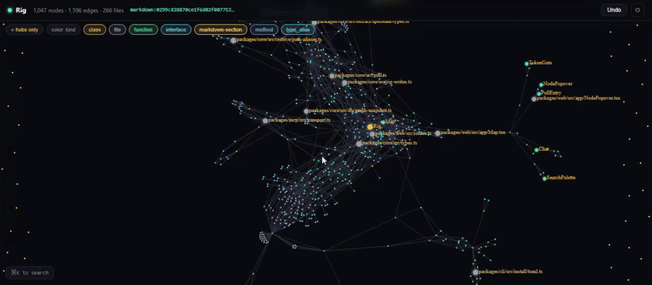

# Rig

**Watch your codebase become a constellation — and give your AI agent a map of it.**

<p align="center">
  <a href="https://www.npmjs.com/package/rig-constellation"></a>
  <a href="https://github.com/Astralchemist/rig/actions/workflows/ci.yml"></a>
  <a href="LICENSE"></a>
  
</p>

<p align="center">
  <a href="https://github.com/Astralchemist/rig/releases/download/v0.1.0/demo.mp4">
    
  </a>
  <br>
  <em><a href="https://github.com/Astralchemist/rig/releases/download/v0.1.0/demo.mp4">▶ Watch the full demo with audio</a></em>
</p>

Rig builds a local-first semantic knowledge graph of your project, renders it as an interactive map you can fly through, and exposes it to coding agents (Claude Code, Cursor, Codex, …) over MCP. Your agent stops grepping blindly and starts navigating — by structure, by meaning, and by what it's touched before.

Everything runs on your machine. No API key, no upload, nothing leaves your laptop.

---

## Quickstart

In any project directory:

```bash
npx rig-constellation
```

(Have [Bun](https://bun.sh)? `bunx rig-constellation` works too.) That's the whole thing. One command:

```
  ⬡ Rig — mapping my-project
  http://localhost:7491

  ✓ initialized  ./.rig
  ✓ map live    http://localhost:7491
  → 1/6 extract      ██████████████████ 212/212
  → 5/6 hubness      ████████████████░░
  ✓ indexed     1,204 nodes · 3,891 edges · 212 files · 36 skills
  ✓ wired Claude Code  project
      wrote     .mcp.json
      wrote     .claude/settings.json
      wrote     CLAUDE.md

  press Ctrl-C to stop the map.
```

It initializes `.rig/`, opens the live map **first**, then indexes your code so the
graph assembles in the already-open browser tab in real time, and wires whichever
agent it detects into this project, listing every file it writes. The map title and
port are derived per project, so two checkouts can run side by side on stable,
distinct ports. Re-run any time, or use the explicit subcommands below.

> The command is `rig` (alias: `rig-constellation`). Prefer a global install?
> `npm i -g rig-constellation` (or `bun install -g rig-constellation`), then `rig start`.
> Installed locally with `npm i rig-constellation`? The binary lives in `node_modules/.bin` —
> run it with `npx rig start` (or install with `-g` to get `rig` on your `PATH`).

---

## What you get

- **A map of your codebase.** Files, symbols, calls, imports, and dependencies as a navigable graph — not a file tree.
- **Magnetic pull.** Ask "what's related to X" and get a ranked answer that blends graph distance, semantic similarity, and what's been active recently.
- **Hubs.** The structurally important anchors surface first, so a 5k-node graph stays legible.
- **Dependency intelligence.** "What version of X do I have?" and "what's declared but never imported?" become one-hop graph queries.
- **Waypoints.** Your agent drops durable markers at decisions and constraints that survive context-window compaction — so a new session picks up oriented.
- **An MCP tool surface** your agent calls directly: search, pull, callers/callees, impact, hubs, deps, and more.

---

## What your agent does differently

Without a map, an agent answers *"what breaks if I change `parseConfig`?"* by grepping the string and reading whatever files match — blind, lossy, and token-expensive.

With Rig it's one call:

```
rig_impact parseConfig
→ 7 transitive callers, ranked:
   loadSettings          calls · depth 1
   bootstrap             calls · depth 2
   __tests__/config…     tests · depth 1
   …
```

And *"what else should I look at?"* isn't a guess — `rig_pull` returns related anchors scored by graph distance, on-device embedding similarity, and recent activity, with the three components broken out so the ranking is **explainable, not a black box**:

```
rig_pull parseConfig
→ { node: "validateSchema", score: 0.81,
    components: { structural: 0.4, semantic: 0.9, recency: 0.7 } }
```

That ranked, self-explaining retrieval — not a flat grep dump — is the difference.

---

## Privacy & local-first

- Embeddings run locally via a small on-device model (`bge-small`). **No API key required.**
- The graph lives in `.rig/rig.db` in your project. `rig` auto-adds `.rig/` to your `.gitignore`.
- Nothing is uploaded. The map UI is served on loopback only.

---

## Wiring your agent

`bunx rig-constellation` auto-detects the agents you have installed and wires them **into
the current project** — it never edits your user-level config. To wire one explicitly:

```bash
rig install claude            # also: cursor · codex · opencode
rig install claude --global   # your user-level config instead: applies to every project
rig uninstall claude          # remove exactly what install added (--all · --global · --dry-run)
```

| Agent | Project (default) | `--global` |
|---|---|---|
| Claude Code | `.mcp.json` · `.claude/settings.json` · `CLAUDE.md` | `~/.claude.json` · `~/.claude/settings.json` · `~/.claude/CLAUDE.md` |
| Cursor | `.cursor/mcp.json` · `.cursor/cli.json` · `.cursor/rules/rig.mdc` | `~/.cursor/mcp.json` |
| Codex CLI | — user-level only | `~/.codex/config.toml` · `~/.codex/AGENTS.md` |
| opencode | — user-level only | `~/.config/opencode/opencode.jsonc` · `~/.config/opencode/AGENTS.md` |

Each install merges Rig's MCP server entry, Rig's per-tool approval policy (in the
agent's own permission format), and a short usage guide between `<!-- rig:begin -->`
markers, leaving the rest of each file alone — re-running it is safe. The agent spawns
`rig serve --mcp` on demand; Claude Code asks you once to approve a server from a
project's `.mcp.json`. In a directory without `.rig/`, the server still starts and every
tool answers with how to fix it (`rig init` or `rig start`).

OpenRouter is an API, not an MCP host: `rig install openrouter` only writes a reference
config to copy into the MCP client you use with it.

---

## Commands

| Command | What it does |
|---|---|
| `rig start` | One-shot: init + index + wire agent + open the live map |
| `rig install <agent>` | Wire an agent into this project (`--global` for your user-level config) |
| `rig uninstall <agent>` | Remove exactly what install added (`--all`, `--global`, `--dry-run`) |
| `rig index` | Extract + write nodes (`--include` / `--exclude <glob>`) |
| `rig sync` | Incremental update |
| `rig query` | CLI search |
| `rig serve --all` | Start MCP and/or the web map (`--mcp` / `--web` / `--no-auth`; `--path <dir>` for another project) |
| `rig status` | Index health |
| `rig doctor` | Diagnose environment, db, model cache, agent configs |
| `rig export-docs` | Render waypoints into a markdown doc tree |

Run `rig --help` for the full list.

---

## How it works

`.contracts/` is the declarative source of truth (tools, anchors, migrations, events); `bun run gen` emits the matching code into `generated/`. The graph is plain SQLite. Retrieval is a single magnetic-pull scoring function over structural edges, on-device embeddings, and recency. The map UI is a force-graph over WebSocket.

- `packages/core` — the `Rig` class: DB, extraction, graph, embeddings, magnetic pull
- `packages/mcp` — MCP stdio server + tool dispatch
- `packages/web` — Fastify + WebSocket + React map UI
- `packages/cli` — the `rig` binary
- `packages/contracts` — `defineToolContract` & friends

See [`docs/contracts.md`](docs/contracts.md) to add a tool, [`docs/integration.md`](docs/integration.md) for the architecture, and [`COMPATIBILITY.md`](COMPATIBILITY.md) for the stability promise.

---

## Requirements

- [Bun](https://bun.sh) ≥ 1.1 (primary), or Node ≥ 20 (fallback).
- Works on macOS, Linux, and Windows.

---

## Contributing

Adding a tool means touching one file in `.contracts/` and one implementation — the generator wires the rest. Start with [`docs/contracts.md`](docs/contracts.md), then [`docs/integration.md`](docs/integration.md) for where new ideas plug in. Stable tools are protected by a compatibility gate (`bun run check:compat`); see [`COMPATIBILITY.md`](COMPATIBILITY.md).

## License

[Apache-2.0](LICENSE). Rig's extraction layer is derived from [CodeGraph](https://github.com/colbymchenry/codegraph) (MIT, © Colby Mchenry); those portions remain under their original MIT terms — see [`LICENSE-CODEGRAPH.txt`](LICENSE-CODEGRAPH.txt) and [`NOTICE`](NOTICE). With thanks.
